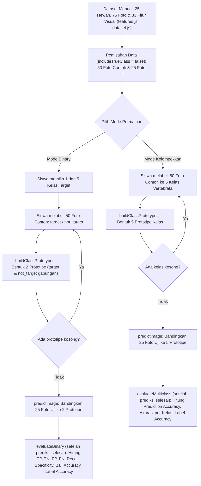

# Dokumentasi Teknis Algoritma — Fauna AI Quest

Dokumen ini merupakan referensi teknis resmi untuk algoritma klasifikasi yang digunakan sebagai mekanisme utama pada **Fauna AI Quest** (`public/assets/js/`). Seluruh penjelasan, nama fungsi, struktur data, rumus, dan metrik evaluasi di dalam dokumen ini merujuk langsung pada implementasi aktual di repository.

---

## A. Gambaran Umum Algoritma

Fauna AI Quest menggunakan pendekatan **Class Prototype Similarity** berbasis aturan matematis sederhana dan deterministik. Secara ringkas, cara kerjanya adalah sebagai berikut:

1. **Karakteristik gambar didefinisikan secara manual** oleh pengembang dalam kamus fitur visual terstruktur ([`features.js`](../public/assets/js/features.js)).
2. **Pemain memberikan label** terhadap gambar contoh selama sesi permainan berlangsung.
3. **Sistem membentuk prototipe kelas** secara sementara sebagai vektor rata-rata fitur dari contoh-contoh yang diberi label oleh pemain.
4. **Gambar uji dibandingkan terhadap prototipe** menggunakan jarak Euclidean ternormalisasi per kelompok fitur untuk menentukan prediksi kelas terdekat. Berbeda dengan *k-Nearest Neighbors* (KNN) yang membandingkan gambar uji terhadap sejumlah contoh individual satu per satu, *Class Prototype Similarity* hanya membandingkan gambar uji terhadap satu vektor prototipe rata-rata untuk tiap kelas.
5. **Sistem tidak melakukan pelatihan model machine learning** (tidak menggunakan KNN, CNN, MobileNet, TensorFlow, maupun pustaka *computer vision* apa pun) dan tidak mengekstrak fitur otomatis dari piksel gambar.

Pembentukan prototipe di sini adalah **agregasi statistik sementara** dari label pemain pada sesi berjalan, bukan proses *training* bobot model machine learning.

---

## B. Dataset

Dataset utama didefinisikan dalam [`dataset.js`](../public/assets/js/dataset.js) (`window.FaunaDataset`) dan terdiri dari:

- **5 kelas vertebrata**: Mamalia, Aves, Reptil, Amfibi, dan Pisces.
- **25 jenis hewan**, dengan komposisi seimbang **5 jenis hewan per kelas**.
- **3 foto per jenis hewan**, sehingga total terdapat **75 foto**.
- **Pembagian data**:
  - **Foto 1 dan Foto 2** dari tiap hewan (`50` foto) berperan sebagai **`sampleImages`** (gambar contoh yang diberi label oleh pemain).
  - **Foto 3** dari tiap hewan (`25` foto) berperan sebagai **`testImage`** (gambar uji yang tidak ditampilkan saat pelabelan dan hanya diprediksi setelah prototipe terbentuk).
- **Unit data independen**: Setiap foto contoh (Foto 1 dan Foto 2) diperlakukan sebagai satu unit data independen yang memiliki representasi 33 fitur sendiri dan menyimpan label siswa sendiri di `state.labels[imageId]`. Kedua foto dari hewan yang sama **tidak** digabungkan sebelum pembentukan prototipe.

### Pembagian Kelas dan Daftar Hewan

| Kelas (`id`) | Nama | Daftar 5 Hewan | Jumlah Contoh (Foto 1 & 2) | Jumlah Uji (Foto 3) | Total Foto |
| :--- | :--- | :--- | :---: | :---: | :---: |
| `mamalia` | Mamalia | Cheetah, Lumba-lumba, Koala, Panda, Paus | 10 | 5 | 15 |
| `aves` | Aves | Elang, Flamingo, Rangkong, Burung Hantu, Penguin | 10 | 5 | 15 |
| `reptil` | Reptil | Buaya, Iguana, Kadal, Ular, Penyu | 10 | 5 | 15 |
| `amfibi` | Amfibi | Axolotl, Kadal Air, Salamander, Kodok, Katak | 10 | 5 | 15 |
| `pisces` | Pisces | Ikan Pari, Belut, Ikan Buntal, Kuda Laut, Hiu | 10 | 5 | 15 |
| **Total** | **5 Kelas** | **25 Jenis Hewan** | **50** | **25** | **75** |

---

## C. Representasi Fitur Visual

Setiap foto dalam dataset direpresentasikan secara manual menggunakan **33 fitur visual** yang terbagi ke dalam **4 kelompok fitur** di [`features.js`](../public/assets/js/features.js) (`FEATURE_GROUPS`, masing-masing kelompok memiliki bobot awal `weight: 0.25`).

### Arti Nilai Fitur

Setiap fitur pada suatu foto bernilai salah satu dari tiga kondisi berikut:
- **`1`**: Karakteristik terlihat jelas pada foto.
- **`0`**: Karakteristik jelas tidak ada dan bagian tubuh yang relevan terlihat pada foto.
- **`null`**: Karakteristik tidak dapat dipastikan dari foto (tertutup, terpotong oleh bingkai, sudut pandang tidak memperlihatkan bagian tubuh terkait, atau buram).

Seluruh nilai fitur diisi secara manual oleh pengembang berdasarkan pengamatan visual tiap foto, bukan hasil ekstraksi piksel otomatis.

### Tabel 33 Fitur Visual (`FEATURE_GROUPS`)

| Kelompok (`id`, Bobot) | ID Fitur (`id`) | Definisi (`label`) |
| :--- | :--- | :--- |
| **Penutup Tubuh** (`body_covering`, `0.25`) | `feathers` | Bulu burung terlihat |
| | `fur` | Rambut atau bulu mamalia terlihat |
| | `visible_scales` | Sisik terlihat jelas pada permukaan tubuh |
| | `smooth_bare_skin` | Kulit terbuka berpermukaan relatif halus |
| | `rough_bare_skin` | Kulit terbuka kasar atau berbintil |
| | `hard_shell` | Cangkang keras terlihat |
| | `bony_plates` | Lempeng atau struktur keras bersegmen terlihat |
| **Alat Gerak & Sirip** (`locomotion_fins`, `0.25`) | `bird_wings` | Sayap burung terlihat (termasuk sayap penguin) |
| | `two_legs` | Dua kaki terlihat |
| | `four_legs` | Empat kaki terlihat |
| | `enlarged_hind_legs` | Kaki belakang tampak lebih besar atau kuat |
| | `paired_front_fins` | Sepasang sirip dada / depan berbentuk dayung terlihat |
| | `dorsal_fin` | Sirip punggung terlihat |
| | `vertical_tail_fin` | Sirip ekor berbentuk vertikal terlihat |
| | `horizontal_tail_flukes` | Ekor fluke horizontal terlihat |
| | `external_gills` | Insang luar terlihat |
| | `gill_slits` | Celah insang terlihat |
| **Bentuk Tubuh** (`body_shape`, `0.25`) | `elongated_body` | Tubuh terlihat memanjang |
| | `streamlined_body` | Bentuk tubuh ramping untuk bergerak di air |
| | `flattened_disc_body` | Tubuh pipih melebar seperti cakram |
| | `rounded_body` | Tubuh berbentuk bulat atau gempal |
| | `upright_body` | Orientasi tubuh terlihat tegak |
| | `long_neck` | Leher terlihat panjang |
| **Struktur Khas** (`distinctive_structures`, `0.25`) | `bird_beak` | Paruh burung terlihat |
| | `hooked_beak` | Ujung paruh burung melengkung seperti kait |
| | `casque` | Struktur tanduk (casque) di atas paruh rangkong |
| | `owl_facial_disc` | Cakram wajah burung hantu terlihat |
| | `long_snout` | Moncong terlihat panjang |
| | `tail_whip` | Ekor panjang menyerupai cambuk terlihat |
| | `curled_tail` | Ekor melengkung atau melingkar terlihat |
| | `spines` | Duri pada permukaan tubuh terlihat |
| | `dorsal_crest` | Jambul atau deretan duri punggung terlihat |
| | `tubular_snout` | Moncong berbentuk tabung terlihat |

---

## D. Pembentukan Prototipe Kelas

Pembentukan prototipe dilakukan oleh fungsi `buildClassPrototypes(sampleImages, studentLabels, classIds, getFeaturesFn)` di [`similarity.js`](../public/assets/js/similarity.js).

Alurnya:
1. Untuk setiap foto contoh `img` di `sampleImages` (50 foto independen), sistem membaca label pilihan siswa `lbl = studentLabels[img.id]`.
2. Vektor 33 fitur foto tersebut dimasukkan ke kelompok kelas `lbl`.
3. Untuk setiap kelas `c` dan setiap fitur `j`, nilai fitur pada prototipe dihitung sebagai rata-rata nilai numerik yang tersedia (mengabaikan `null`):

$$
P(c, j) = \frac{\sum_{i \in S_c,\, x(i,j) \neq \text{null}} x(i, j)}{N(c, j)}
$$

Keterangan:
- $P(c, j)$: nilai fitur $j$ pada prototipe kelas $c$.
- $S_c$: himpunan seluruh foto contoh yang diberi label $c$ oleh siswa.
- $x(i, j)$: nilai fitur $j$ (`0` atau `1`) pada foto contoh ke-$i$.
- $N(c, j)$: jumlah foto dalam $S_c$ yang memiliki nilai numerik (`0` atau `1`) untuk fitur $j$.
- Jika $N(c, j) = 0$ (seluruh contoh berlabel $c$ bernilai `null` pada fitur $j$), maka $P(c, j) = \text{null}$.
- Jika suatu kelas tidak memiliki satu pun contoh berlabel siswa ($|S_c| = 0$), kelas tersebut dicatat dalam `emptyClasses` dan prototipenya bernilai `null`.

**Penting:** Prototipe sepenuhnya ditentukan oleh label yang diberikan siswa (`studentLabels`), bukan oleh kelas sebenarnya (`classId`) dari hewan tersebut. Jika siswa melabeli foto Elang sebagai `reptil`, maka fitur Elang tersebut ikut membentuk prototipe `reptil`.

---

## E. Perhitungan Kemiripan

Prediksi satu gambar uji dilakukan oleh fungsi `predictImage(testFeatures, prototypes, options)` di [`similarity.js`](../public/assets/js/similarity.js).

### 1. Himpunan Fitur Bersama yang Adil

Agar perbandingan antar kelas kandidat adil dan nilai `null` tidak pernah dianggap sebagai `0`, sistem mengumpulkan himpunan fitur terbandingkan $F_g$ untuk setiap kelompok $g \in \{1, 2, 3, 4\}$. Sebuah fitur $j$ termasuk ke dalam $F_g$ **hanya jika**:
- `testFeatures[j]` bernilai numerik (`0` atau `1`), **dan**
- `prototypes[c][j]` bernilai numerik untuk **semua** kelas kandidat $c$ yang memiliki prototipe non-null.

Kelompok fitur $g$ dianggap valid jika $|F_g| > 0$.

### 2. Syarat Minimal Informasi Visual

Sebelum menghitung jarak, sistem memeriksa ambang batas minimal (default pada `predictImage`):
- Jumlah total fitur terbandingkan $\sum |F_g| \ge 3$ (`minFeatures = 3`).
- Jumlah kelompok fitur valid $\ge 2$ (`minGroups = 2`).

Jika syarat ini tidak terpenuhi, prediksi tidak dipaksakan dan fungsi mengembalikan `status: 'unclassified'` dengan `reason: 'insufficient_features'`.

### 3. Rumus Jarak per Kelompok Fitur

Untuk setiap kelompok fitur valid $g$ dan kelas kandidat $c$, dihitung jarak Euclidean ternormalisasi (RMSD dalam rentang $[0, 1]$):

$$
D_g(x_{\text{uji}}, P_c) = \sqrt{\frac{1}{|F_g|} \sum_{j \in F_g} \left(x_{\text{uji}, j} - P(c, j)\right)^2}
$$

### 4. Rumus Jarak Total dan Normalisasi Bobot Kelompok

Keempat kelompok fitur memiliki bobot awal yang sama ($w_g = 0{,}25$). Apabila ada kelompok yang tidak memiliki fitur terbandingkan ($|F_g| = 0$), bobot kelompok valid dinormalisasi terhadap total bobot kelompok yang aktif ($G_{\text{valid}}$):

$$
D_{\text{total}}(x_{\text{uji}}, P_c) = \frac{\sum_{g \in G_{\text{valid}}} w_g \cdot D_g(x_{\text{uji}}, P_c)}{\sum_{g \in G_{\text{valid}}} w_g}
$$

Karena setiap $x_{\text{uji}, j} \in \{0, 1\}$ dan $P(c, j) \in [0, 1]$, maka $D_g \in [0, 1]$ dan $D_{\text{total}} \in [0, 1]$.

### 5. Tingkat Kecocokan Fitur & Penanganan Jarak Sama (`ambiguous_tie`)

Setelah jarak terhadap semua kelas kandidat diurutkan dari terkecil ke terbesar ($d_1 \le d_2 \le \dots$):
- **Penanganan seri (`ambiguous_tie`)**: Jika selisih dua jarak teratas memenuhi $|d_2 - d_1| \le 10^{-9}$ (`tieTolerance = 1e-9`), prediksi dinyatakan ambigu (`status: 'unclassified'`, `reason: 'ambiguous_tie'`, `predictedClass: null`).
- **Prediksi kelas**: Jika tidak seri, kelas dengan jarak terkecil $d_1$ dipilih sebagai `predictedClass`.
- **Tingkat kecocokan fitur (`similarity`)**: Dihitung sebagai persentase kedekatan fitur pada rentang `0%`–`100%`:

$$
\text{Tingkat Kecocokan} = \text{clamp}\big((1 - d_1) \times 100,\; 0,\; 100\big)
$$

> **Catatan:** Tingkat kecocokan fitur (`similarity`) menyatakan seberapa dekat profil fitur gambar uji terhadap prototipe kelas terpilih, **bukan** probabilitas atau peluang kebenaran prediksi.

- **Penanda jarak tipis (`lowMargin`)**: Sistem menghitung selisih jarak dua kandidat terdekat `margin = d_2 - d_1` dan menandai `lowMargin: true` apabila `margin < 0.03` (`lowMarginThreshold = 0.03`). Flag ini **tidak mengubah** `status` (tetap `'classified'`) maupun hasil `predictedClass`, melainkan hanya berfungsi sebagai peringatan visual (tooltip *"Selisih jarak antar prototipe tipis"* di `binary.js` atau *"Selisih jarak antar kelas sangat tipis"* di `multiclass.js`) bahwa tingkat kemiripan dengan kelas peringkat kedua sangat berdekatan.

### Contoh Perhitungan Sederhana

Misalkan pada sebuah gambar uji hanya ada 2 kelompok fitur valid (bobot masing-masing $0{,}25$, total bobot valid $0{,}50$):
- Kelompok `body_covering` ($F_1 = \{\text{feathers}, \text{fur}\}$): uji `[1, 0]`, prototipe Aves `[1.0, 0.0]` $\rightarrow D_1 = \sqrt{\frac{0^2 + 0^2}{2}} = 0$.
- Kelompok `distinctive_structures` ($F_4 = \{\text{bird\_beak}\}$): uji `[1]`, prototipe Aves `[1.0]` $\rightarrow D_4 = 0$.
- Jarak total ke Aves: $D_{\text{total}} = \frac{0{,}25(0) + 0{,}25(0)}{0{,}50} = 0$, sehingga tingkat kecocokan fitur $= (1 - 0) \times 100 = 100\%$.

---

## F. Algoritma Mode Binary

Implementasi antarmuka dan orkestrasi Mode Binary berada di [`binary.js`](../public/assets/js/binary.js).

### Langkah-langkah Gameplay & Klasifikasi
1. Pemain memilih satu dari lima kelas target (`mamalia`, `aves`, `reptil`, `amfibi`, atau `pisces`).
2. Pemain memberi label pada **50 foto contoh** sebagai `'target'` (*Termasuk [Target]*) atau `'not_target'` (*Bukan [Target]*).
3. Pada `runBinaryPrediction()`, sistem memanggil `FS.buildClassPrototypes(SAMPLE_IMAGES, state.labels, ['target', 'not_target'], ...)` untuk membentuk **dua prototipe**:
   - **`target`**: rata-rata fitur seluruh foto contoh yang diberi label `'target'`.
   - **`not_target`**: rata-rata gabungan dari seluruh foto contoh yang diberi label `'not_target'` (bukan empat prototipe terpisah per kelas asli).
   - Jika salah satu kelompok kosong (`built.emptyClasses.length > 0`), prediksi dibatalkan dan pemain diminta memperbaiki label terlebih dahulu.
4. Untuk setiap dari **25 foto uji**, `FS.predictImage(t.features, built.prototypes)` membandingkan foto uji dengan prototipe `target` dan `not_target`.
5. Prototipe dengan jarak terkecil menjadi prediksi (`'target'` atau `'not_target'`).

### Metrik Evaluasi Mode Binary (`evaluateBinary`)

Setelah prediksi selesai, evaluator membandingkan hasil terhadap `classId` sebenarnya (`actualIsTarget = t.classId === targetClassId`):
- **TP (True Positive)**: Hewan target diprediksi `'target'`.
- **TN (True Negative)**: Hewan bukan target diprediksi `'not_target'`.
- **FP (False Positive)**: Hewan bukan target salah diprediksi `'target'`.
- **FN (False Negative)**: Hewan target salah diprediksi `'not_target'`.
- **Accuracy**: $\frac{\text{TP} + \text{TN}}{\text{Total Uji}} \times 100\%$
- **Recall Target**: $\frac{\text{TP}}{\text{TP} + \text{FN}} \times 100\%$
- **Specificity**: $\frac{\text{TN}}{\text{TN} + \text{FP}} \times 100\%$
- **Balanced Accuracy**: $\frac{\text{Recall Target} + \text{Specificity}}{2}$
- **Label Accuracy**: Persentase ketepatan label siswa pada 50 foto contoh terhadap label target/bukan target yang seharusnya.
- **Penanganan `unclassified` (`insufficient_features` & `ambiguous_tie`)**: Jika ada foto uji yang berstatus `status !== 'classified'`, foto tersebut dicatat dalam `unclassifiedCount` dan **tidak** dimasukkan ke `TP`, `TN`, `FP`, maupun `FN`. Namun, foto tersebut **tetap dihitung** dalam pembagi `totalTest` (`25`), sehingga prediksi `unclassified` menurunkan `Accuracy` ($\frac{\text{TP} + \text{TN}}{\text{Total Uji}}$), sementara `Recall Target` dan `Specificity` tetap dihitung dari kasus yang terklasifikasi (`TP + FN` dan `TN + FP`).

---

## G. Algoritma Mode Kelompokkan

Implementasi antarmuka dan orkestrasi Mode Kelompokkan berada di [`multiclass.js`](../public/assets/js/multiclass.js).

### Langkah-langkah Gameplay & Klasifikasi
1. Pemain memberi satu dari lima label kelas vertebrata (`mamalia`, `aves`, `reptil`, `amfibi`, `pisces`) kepada **50 foto contoh**.
2. Pada `runMulticlassPrediction()`, sistem memanggil `FS.buildClassPrototypes(SAMPLE_IMAGES, state.labels, CLASS_IDS, ...)` untuk membentuk **5 prototipe kelas** berdasarkan label siswa.
3. **Penanganan kelas kosong**: Jika terdapat kelas yang belum memiliki satu pun contoh berlabel (`built.emptyClasses.length > 0`), sistem menampilkan peringatan nama kelas yang kosong dan mengembalikan pemain ke layar pelabelan (`go('teach', { keepLabels: true })`) tanpa menjalankan prediksi.
4. Setiap dari **25 foto uji** dibandingkan dengan kelima prototipe melalui `FS.predictImage(t.features, built.prototypes)`.
5. Kelas dengan jarak terkecil menjadi prediksi `predictedClass`.
6. Setelah seluruh 25 prediksi selesai, hasil dievaluasi terhadap kelas sebenarnya.

### Metrik Evaluasi Mode Kelompokkan (`evaluateMulticlass`)
- **Prediction Accuracy (Akurasi Prediksi Fauna)**: $\frac{\text{Jumlah Prediksi Benar}}{\text{25 Foto Uji}} \times 100\%$.
- **Per-Class Accuracy**: Ketepatan prediksi pada masing-masing kelas (dari 5 foto uji per kelas).
- **Label Accuracy (Ketepatan Label Siswa)**: $\frac{\text{Jumlah Label Contoh Benar}}{\text{50 Foto Contoh}} \times 100\%$.
- **Penanganan `unclassified` (`insufficient_features` & `ambiguous_tie`)**: Foto uji dengan `status !== 'classified'` dicatat dalam `unclassifiedCount` dan `perClass[c].unclassified`, serta **tidak** dihitung sebagai `correctPredictions` maupun `wrongPredictions`. Karena foto tersebut tetap masuk dalam pembagi `totalTest` (`25`) dan `perClass[c].total` (`5`), setiap kasus `unclassified` tetap menurunkan `Prediction Accuracy` dan akurasi per kelas.

---

## H. Pemisahan Prediksi dan Evaluasi

Arsitektur kode memisahkan secara ketat data yang boleh diakses saat prediksi dan data kebenaran (*ground truth*) untuk evaluasi:

- Baik `binary.js` maupun `multiclass.js` memuat `SAMPLE_IMAGES = FD.getSampleImages(false)` dan `TEST_IMAGES = FD.getTestImages(false)` dengan parameter `includeTrueClass = false`, sehingga objek gambar contoh dan uji yang dipakai untuk membentuk prototipe serta memprediksi **tidak membawa properti `classId`**.
- Fungsi `buildClassPrototypes` hanya membaca `studentLabels[img.id]` dan fitur visual (`img.features` atau `FF.get(id)`).
- Fungsi `predictImage` hanya menerima `testFeatures` dan `prototypes`, tanpa akses ke `classId` maupun `trueClass`.
- Properti `classId` (via `FD.getSampleImages(true)` dan `FD.getTestImages(true)`) **hanya** dipanggil setelah seluruh prediksi selesai, khusus di dalam `evaluateBinary` dan `evaluateMulticlass`.

### Perbedaan Dua Metrik Utama
- **Label Accuracy**: Mengukur ketepatan pemain/siswa saat memberi label pada 50 foto contoh.
- **Prediction Accuracy**: Mengukur ketepatan prediksi Fauna AI Quest pada 25 foto uji berdasarkan prototipe yang terbentuk dari label siswa tersebut.

---

## I. Alur Proses Algoritma

---

## J. Keterbatasan Algoritma

Berdasarkan analisis implementasi dan struktur data saat ini, terdapat beberapa keterbatasan aktual:

1. **Representasi fitur manual bergantung pada pengamatan foto**: Fitur tidak mendeteksi objek secara otomatis dari piksel gambar, sehingga kualitas representasi bergantung pada konsistensi definisi fitur manual tiap foto.
2. **Satu prototipe per kelas pada Mode Kelompokkan**: Kelas yang memiliki variasi morfologi sangat lebar (seperti Mamalia yang mencakup mamalia darat berambut berkaki empat dan mamalia air berkulit halus bersirip) hanya diwakili oleh satu vektor rata-rata.
3. **Penggabungan 4 kelas bukan target pada Mode Binary**: Prototipe `not_target` merata-ratakan empat kelas yang berbeda sekaligus, sehingga ciri ekstrem dari satu kelas (misalnya Aves) dapat menggeser rata-rata `not_target` dan memicu *False Positive* pada target yang beragam seperti Mamalia atau Amfibi.
4. **Evaluasi pada spesies yang sama dengan contoh**: Foto uji (Foto 3) berasal dari 25 jenis hewan yang sama dengan foto contoh (Foto 1 & 2), sehingga hasil evaluasi belum menguji kemampuan generalisasi ke spesies baru di luar 25 hewan tersebut.
5. **Fitur tidak tampak (`null`) tidak dapat dihitung**: Fitur yang tertutup atau tidak terlihat pada foto uji maupun di salah satu prototipe kandidat dikeluarkan dari himpunan fitur terbandingkan.

### Contoh Kasus: Lumba-lumba dan Paus pada Mode Kelompokkan

Pada simulasi baseline (`50/50` label benar), **Lumba-lumba** (`lumba-lumba-3`) dan **Paus** (`paus-3`) diprediksi sebagai **`pisces`** dengan jarak yang sangat tipis terhadap `mamalia` (`0.2222` vs `0.2472` untuk Lumba-lumba; `0.2159` vs `0.2264` untuk Paus). Hal ini terjadi karena:
- 6 dari 10 foto contoh Mamalia adalah mamalia darat (`cheetah`, `koala`, `panda`) sehingga prototipe `mamalia` didominasi nilai `fur = 0.60` dan `four_legs = 0.43`.
- Sebaliknya, pada foto uji `lumba-lumba-3` dan `paus-3`, fitur `smooth_bare_skin = 1` dan `paired_front_fins = 1` lebih dekat ke prototipe `pisces`, sementara ciri pembeda utama mamalia laut (`horizontal_tail_flukes`) bernilai `null` karena ekor fluke horizontal tidak tampak pada kedua foto uji tersebut.

Kasus ini merupakan konsekuensi alami dari pendekatan kemiripan fitur visual berbasis satu prototipe rata-rata per kelas dan menjadi bahan diskusi edukatif yang baik mengenai keterbatasan AI berbasis ciri permukaan.

---

## K. Hasil Simulasi Internal

Hasil berikut diperoleh dari simulasi internal menggunakan skrip validasi Node.js pada implementasi saat ini dengan skenario **seluruh 50 label contoh diisi benar** (`Label Accuracy: 100%`).

### Mode Kelompokkan
- **Label Accuracy**: `100%` (`50/50`)
- **Prediction Accuracy**: `92%` (`23/25`)
- **Akurasi per kelas**:
  - **Mamalia**: `3/5` (`60%`) — salah pada Lumba-lumba dan Paus (`-> pisces`)
  - **Aves**: `5/5` (`100%`)
  - **Reptil**: `5/5` (`100%`)
  - **Amfibi**: `5/5` (`100%`)
  - **Pisces**: `5/5` (`100%`)

### Mode Binary (Akurasi per Kelas Target)
- **Mamalia**: `72%`
- **Aves**: `100%`
- **Reptil**: `96%`
- **Amfibi**: `80%`
- **Pisces**: `92%`

> **Catatan:** Angka-angka di atas merupakan hasil simulasi deterministik internal pada dataset 25 hewan yang tersedia (bukan jaminan performa umum pada dataset lain)